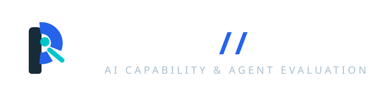
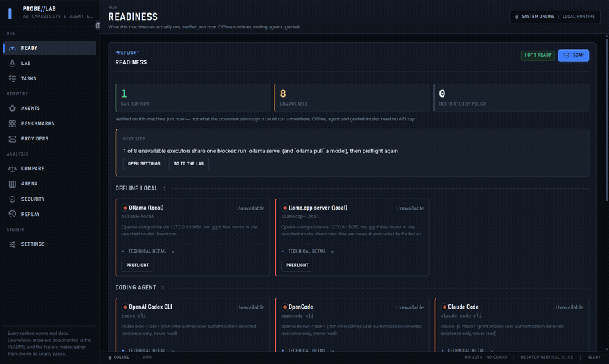
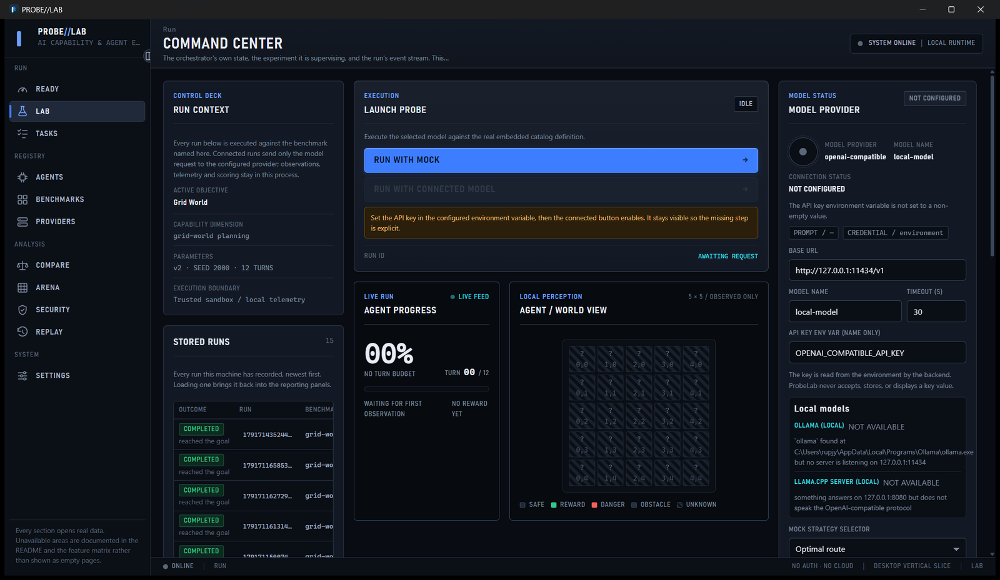
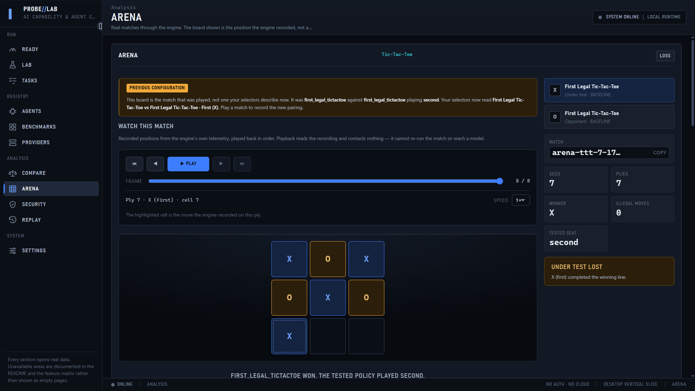
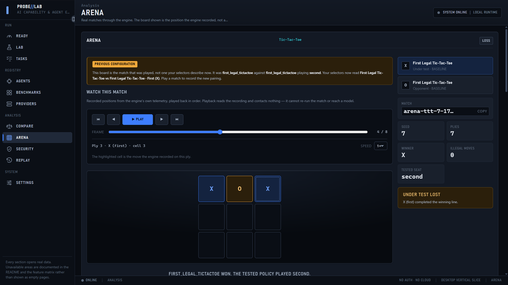
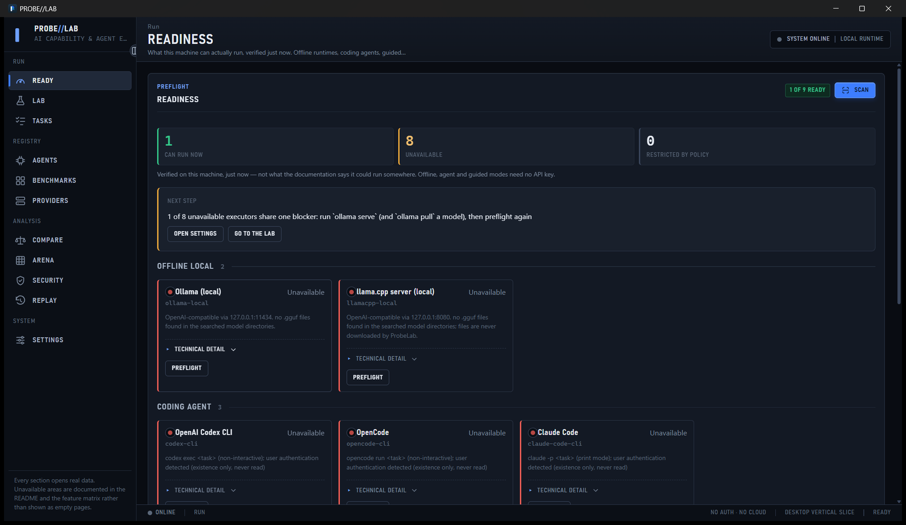

<p align="left">
  
</p>

# ProbeLab

A desktop workstation for running AI models and agents against fixed tasks and benchmarks, observing what they actually do, and replaying the result — locally, with no account and no cloud.

<p align="left">
  <a href="https://github.com/MadB0i/ProbeLab/releases/latest"></a>
  <a href="https://github.com/MadB0i/ProbeLab/releases/latest"></a>
  
  
</p>

## Demo

Recorded from the built Windows executable. The benchmark run, the match, and the playback are the engine's real work.



## What it does

<p align="center">
  
</p>

<p align="center">
  
</p>

<p align="center">
  
</p>

<p align="center">
  
</p>

## Features

- **Benchmark execution** — runs a selected model or agent against an embedded benchmark catalog, with a live progress feed and the run's event stream.
- **Durable run history** — completed runs persist to SQLite and reopen after restart, with lifecycle state, episode counts, and scores.
- **Match arena** — plays two policies against each other through the engine and records every position, with frame-by-frame playback, a scrubber, and a winning line from the engine.
- **Task packages** — save a guided task to disk as a self-contained, portable package you can open and run elsewhere.
- **Comparison** — selects two stored runs and states, in plain language, why they may or may not be comparable.
- **Readiness preflight** — checks the machine before a run and names the specific blocking step and its fix.
- **Replay** — re-reads recorded run events without contacting anything.

## Execution modes

| Mode | What runs | Status |
|---|---|---|
| Baseline policy | A deterministic built-in policy. No network, no key, no model. | Supported, default |
| Connected model | An OpenAI-compatible `/v1/chat/completions` endpoint over HTTPS or loopback. | Supported |

The baseline mode is a real execution path, not a placeholder: the benchmark definition, engine, scoring, and telemetry are identical, and the run is labelled with the policy it used.

## Limitations

These are the actual boundaries of the current build, stated plainly.

- **No vendor model has been measured.** The connected path is proven end to end against a local stand-in provider. That the transport speaks the right protocol is not the same claim as a benchmark result from a specific vendor's model.
- **One provider is selectable.** The OpenAI-compatible adapter is the only one the desktop product admits. Anthropic and Gemini adapters exist as library artifacts with unit tests but are not wired into the product.
- **One Arena game.** Tic-Tac-Toe only. Connect Four, RPS, Battleship, and a human seat are declared in the feature matrix as not implemented.
- **Replay of a stored run shows measurements and provenance, not the original planner's decisions or live timeline.** Those were never persisted; the panel leaves them absent rather than reconstructing them.
- **Not independently audited.** The security model is designed and enforced in-process; it has not been through an external review, and no independent security guarantee is claimed.
- **No scientific validation.** Benchmarks are internally consistent and reproducible from a recorded seed. Nothing here has been validated as a measure of model capability in the research sense.

## Install

Download the latest release and run the installer:

- **`ProbeLab_<version>_x64-setup.exe`** — NSIS installer, recommended.
- **`ProbeLab_<version>_x64_en-US.msi`** — MSI installer for managed deployment.

Verify the download against the published `SHA256SUMS.txt`.

No installation is required to build or run from source — see below.

## Build from source

Requires [Rust](https://www.rust-lang.org/tools/install) (edition 2024, Rust 1.97+), Node.js 20+, and the WebView2 runtime (present by default on Windows 11).

```bash
git clone https://github.com/MadB0i/ProbeLab.git
cd ProbeLab
cargo test --workspace          # Rust engine, lab, sandbox, broker, telemetry
pnpm --dir apps/desktop install
pnpm --dir apps/desktop test    # Frontend
pnpm --dir apps/desktop tauri build
```

The build produces `target/release/probelab-desktop.exe` plus NSIS and MSI bundles under `target/release/bundle/`.

### Layout

| Path | Contents |
|---|---|
| `crates/engine` | Deterministic game and environment logic |
| `crates/lab` | Experiment orchestration, SQLite persistence, Arena store |
| `crates/sandbox` | Process isolation and the execution boundary |
| `crates/broker` | The single sanctioned path from the UI to an execution |
| `crates/telemetry` | Append-only event recording |
| `apps/desktop` | Tauri shell and React frontend |
| `scripts` | Capture, audit, and release verification scripts |

The Rust crates are the product; the desktop shell is one front end over them.

### Verification

`scripts/` contains the checks used before a release, including native-window capture, route overflow auditing, and durability checks that restart the real executable and confirm the data survives.

## License

[MIT](LICENSE)